 

 

---

### 👨‍💻 Sobre mim

Engenheiro de Software Full Stack com **mais de 6 anos de experiência** construindo soluções escaláveis, do levantamento de requisitos ao deploy. Hoje uno desenvolvimento full stack com **IA generativa**: LLMs, RAG, MCP e integração de APIs de IA em produtos reais.

- 🏦 Atualmente desenvolvendo soluções de investimentos na **Cresol**
- 🤖 Pós-graduando em **Engenharia de IA Aplicada** (UNIPDS / Anhanguera)
- 🎓 Bacharel em **Ciência da Computação** (URI)
- 🤝 Gosto de trabalhar com times multidisciplinares, mentorar e transformar requisitos complexos em soluções simples
- 📍 Erechim, RS, Brasil

### 💼 Experiência

| Período | Empresa | Função |
|---|---|---|
| 2023 – atual | **Cresol Cooperativa** | Desenvolvedor de Software (Java, Quarkus, React) |
| 2021 – 2023 | **Capgemini** | Tech Lead Mobile no App BB do Banco do Brasil (React Native, Angular, Spring Boot) |
| 2019 – 2021 | **Compasso UOL** | Desenvolvedor de Software, front-end para a Natura (React, Node.js, NestJS) |
| 2015 – 2019 | **TolRS** | Analista de Redes (Mikrotik, Ubiquiti, Windows Server, Linux) |

### 🧰 Tecnologias

**Linguagens**

  
  
  
  
  

**Front-end e Mobile**

  
  
  

**Back-end**

  
  
  
  

**IA**

  
  
  
  
  

**Testes e DevOps**

  
  
  
  
  
  
  

### 📊 Estatísticas

  
  

